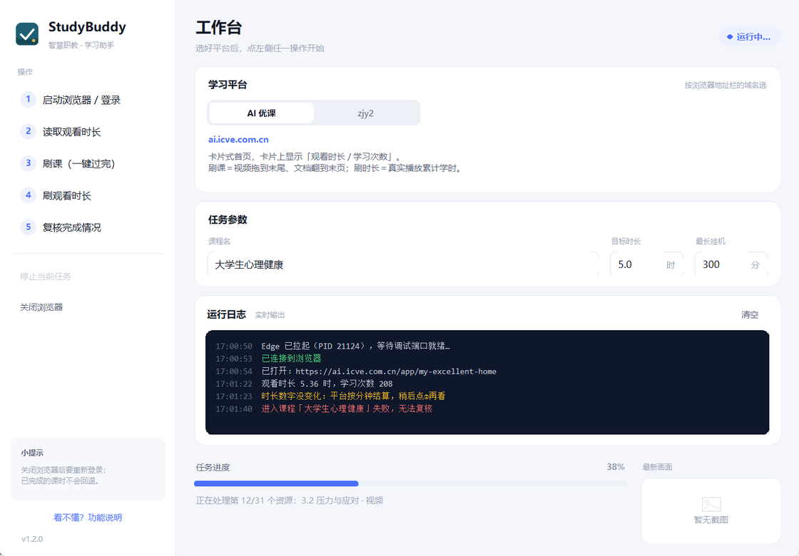

# StudyBuddy · 智慧职教学习助手

> 带图形界面的 Windows 桌面工具，用于批量处理智慧职教（icve：AI 优课 / zjy2）和学习通（mooc2）的课程进度。
> 基于 Python + tkinter（自绘界面）+ Playwright：智慧职教走 CDP 接管本机 Edge，学习通用内嵌驱动开独立有头窗口；提供安装包与免安装版。



## ⚠️ 免责声明

本项目仅供**个人学习、浏览器自动化技术研究**使用。

- 使用本工具产生的任何后果（包括但不限于平台判定异常、成绩与学时无效、账号受限）由使用者自行承担。
- 自动化刷课/刷学时可能违反学校规定与平台用户协议。**请自行判断是否使用**，作者不鼓励也不为此背书。
- 工具不采集、不上传任何账号信息。登录态仅保存在本机 `userdata/` 目录，且已被 `.gitignore` 排除。
- 请勿将本工具用于代刷、售卖等商业或代他人操作场景。
- 自动答题由第三方大模型生成答案，**正确率不可控**；由它提交的成绩、由此产生的后果由使用者承担。

## 功能

| 按钮 | 作用 | 是否真播视频 |
|---|---|---|
| ① 启动浏览器 / 登录 | 先选登录方式：**账号密码**（自动填表，平台弹滑块时人工拖一次）或 **扫码 / 手动**。智慧职教启动受控 Edge；学习通启动独立有头窗口（各自独立 profile，登录态持久化） | — |
| ② 读取学习进度 | AI 优课先读「观看时长 / 学习次数」；该课不计学时时自动改读目录完成度 | — |
| ③ 刷课（一键过完） | 智慧职教：视频拖进度条到结尾、文档翻到末页；学习通：1 倍速真播到结尾（只认视频绿标）。续播弹窗自动关，连续 2 项进度为 0 自动停。课程下拉里的「★ 全部可刷课程」可一次刷完账号下所有可刷课 | 学习通是，智慧职教否 |
| ④ 刷观看时长 | 连续真实播放视频（1x 从头播满整段），累计到目标学时 | 是，必须真播 |
| ⑤ 复核完成情况 | 展开全部模块，统计已完成资源数 | — |
| ⑥ 自动答题（大模型） | 智慧职教：进作业/测验/考试；学习通：抓章节测验（含内嵌）→ 软件调大模型 → 填答提交。答案都由软件自己请求，不需要切到聊天窗口问答 | — |
| ⚙ 大模型设置 | 填接口地址 / 模型名 / API Key（存本机，不内置） | — |
| ❓ 功能说明 | 界面内置的用法解释 | — |

**③ 与 ④ 的目标不同，别混用**：AI 优课的刷课只求目录打勾，可以拖进度条；刷学时是累计首页那个「观看时长」数字，平台只认真实播放时长，拖进度条不计入。学习通没有单独的「刷学时」入口：它的任务点必须 1 倍速播到结尾才算完成，所以 ③ 本身就是真播，且窗口不能最小化。

## 支持的三个平台

看浏览器地址栏选：

| 选项 | 网址 | 页面特征 | 支持 |
|---|---|---|---|
| AI 优课 | `ai.icve.com.cn` | 首页是课程卡片，卡片上写「观看时长 / 学习次数」 | ②③④⑤⑥ |
| zjy2 | `zjy2.icve.com.cn` | 左侧「章节 → 小节 → 资源」树，资源后带百分比 | ②③⑤（②读目录完成度；题目页未适配） |
| 学习通 | `v8.chaoxing.com` / mooc2 | 个人空间课程卡片，章节目录在 iframe 里 | ②③⑤⑥（无④；视频必须播到结尾） |

选错的表现是「进入课程失败」或「资源 0 项」，换另一个选项即可。

### 学习通整合说明

`chaoxing/` 目录是已真机验证的 `chaoxing-suite-v1.4` 脚本套件（详见 `chaoxing/README.md`）。
软件运行时复用 PyInstaller 自带的 Node 与 playwright-core，不需要另装 Node / npm；
套件使用独立浏览器 profile（`<数据目录>/userdata/chaoxing/`），与智慧职教那套 Edge 登录态互不干扰。
答题时软件抓题后直接调用「⚙ 大模型设置」里配置的兼容接口生成答案，再按题号自动填答，
不需要把题目复制到聊天窗口；缺答案会整卷跳过，不会空卷提交。

## 登录方式

点 ① 会先弹「登录方式」：

| 方式 | 适合 | 说明 |
|---|---|---|
| 账号密码 | 替别人刷课、账号主不在身边 | 自动切标签、填表、勾协议、提交；平台弹滑块时**在浏览器窗口里拖一下**，拖完自动继续 |
| 扫码 / 手动 | 自己的号、想用手机确认 | 在弹出窗口里扫码或自己输账号 |

滑块是平台的反自动化验证（智慧职教：腾讯/阿里；学习通：超星），脚本绕过既不可靠也不该做，
所以保留为一次人工动作——但不再需要账号主的手机。

勾选「记住账号密码」会把账号密码**明文**存进本机 `settings.json`；
公用电脑不要勾，替别人刷完可以点「清除已记账号」。

## 快速开始

### 环境要求

- Windows 10 / 11
- **已安装 Microsoft Edge 或 Chrome**（智慧职教复用系统 Edge；学习通会用 Edge/Chrome 开独立有头窗口）
- Python 3.9+（仅源码运行与打包需要，使用发布版不需要）

### 方式一：安装包（推荐）

下载 `StudyBuddy-Setup-x.y.z.exe`，双击按向导安装。特点：

- **不需要管理员权限**，按用户安装到 `%LOCALAPPDATA%\Programs\StudyBuddy`
- 自动创建开始菜单快捷方式，桌面快捷方式可选
- 自带卸载程序（设置 → 应用，或开始菜单里的「卸载 StudyBuddy」）
- 卸载**不会删除**登录态（存放在 `%LOCALAPPDATA%\StudyBuddy`），重装免扫码

> 程序无数字签名，SmartScreen 会拦一次，点「更多信息 → 仍要运行」即可。

### 方式二：免安装包（绿色版）

下载 `StudyBuddy-x.y.z-win64.zip`，解压后双击 `StudyBuddy.exe`。

**整个文件夹**（含 `_internal/`）必须一起复制，exe 单独拷走会闪退。数据（登录态、截图、日志）就放在 exe 旁边，删目录即彻底清除。

| | 安装版 | 免安装版 |
|---|---|---|
| 管理员权限 | 不需要 | 不需要 |
| 快捷方式 | 自动创建 | 手动 |
| 卸载 | 控制面板卸载 | 删文件夹 |
| 数据位置 | `%LOCALAPPDATA%\StudyBuddy` | exe 同目录 |
| 卸载后登录态 | **保留**，重装免登录 | 随目录删除 |

### 源码运行

```bash
pip install -r requirements.txt
python main.py
```

或双击 `启动.bat`。

首次运行 Playwright 若提示缺少驱动，执行一次：

```bash
python -m playwright install-deps   # 非必需，仅用系统 Edge 时可跳过
```

### 打包

```bash
# 1. 打包主程序，产物在 dist/StudyBuddy/
python -m PyInstaller build.spec --noconfirm --clean

# 2. 打包安装包（需先装 Inno Setup 6：winget install JRSoftware.InnoSetup）
"C:\Program Files (x86)\Inno Setup 6\ISCC.exe" installer\studybuddy.iss
# 产物在 installer_out/StudyBuddy-Setup-x.y.z.exe
```

`installer/studybuddy.iss` 里的 `MyAppVersion` 与 `SrcDir` 需与 `config.py` 的 `APP_VERSION`、PyInstaller 输出目录保持一致。

> 注意：`StudyBuddy.exe` 不能单独拷贝，必须与 `_internal/` 同目录。程序无数字签名，首次运行 Windows SmartScreen 会拦一次，点「更多信息 → 仍要运行」即可。

## 使用流程

1. 点「① 启动浏览器 / 登录」，在弹出的 Edge 窗口里登录（二维码或账号密码）。
2. 点「② 读取学习进度」：有学时的课显示「观看时长 x 时 / y 次」，没有学时统计的课
   自动改读目录完成度「x/y（p%）」，看数字是否与手机上一致，确认登录的是自己的号。
3. 点「③ 刷课」把目录里的资源全部打勾。
4. 需要学时再挂「④ 刷观看时长」，填目标小时数与最长挂机分钟数。
5. 点「⑤ 复核完成情况」看统计。任何时候可点「停止当前任务」，已完成项不会回退。

### 用自动答题（⑥）

自动答题是**软件直接调用你填的大模型接口**，不需要任何人在旁边。

1. 点左下角「⚙ 大模型设置」，填三项：接口地址、模型名、API Key，点「测试连接」确认通。
   常见填法：

   | 服务 | 接口地址 | 模型名 |
   |---|---|---|
   | DeepSeek | `https://api.deepseek.com/v1` | `deepseek-chat` |
   | 通义千问 | `https://dashscope.aliyuncs.com/compatible-mode/v1` | `qwen-plus` |
   | Kimi | `https://api.moonshot.cn/v1` | `moonshot-v1-8k` |
   | OpenAI | `https://api.openai.com/v1` | `gpt-4o-mini` |

   Key 只存在本机 `%LOCALAPPDATA%\StudyBuddy\settings.json`（明文）。
   **软件不内置 Key**：这个工具是给人用的，内置等于把额度公开。

2. 点「⑥ 自动答题」，第一次选「否（试运行）」：只解析题目、把模型答案打进日志，
   **不点选、不提交**。核对日志里的题号和答案能对上，再选「是」正式跑。
3. 正式跑会依次进 作业 → 测验（→ 考试，需在设置里勾选），每题作答后回读控件状态，
   提交后把得分记进日志。

**注意**：模型答案不保证全对（尤其简答/填空），考试请慎重；「包含考试」默认关闭，
因为考试通常限时、交卷后不可改。

## 工作原理

```
tkinter GUI
   │  EventBus（队列，跨线程）
   ▼
TaskRunner（每任务一个线程）
   │
   ├── EdgeProc：subprocess 拉起 msedge.exe --remote-debugging-port=9222
   │             只负责启动 / 探活 / 关闭，不持有 Playwright 对象
   │
   └── Browser：本线程 connect_over_cdp(9222) → 操作页面 → finally 断开
```

三个关键设计决策，都是踩坑换来的：

1. **浏览器必须是独立进程，不能交给 Playwright 托管。** Playwright 同步 API 有线程亲和性，跨线程复用连接必然 `TargetClosedError`；每个任务自建 CDP 连接、任务结束断开，浏览器与登录态都不受影响。
2. **断开连接只能用 `pw.stop()`，不能用 `browser.close()`。** 对 `connect_over_cdp()` 得到的 Browser，`close()` 的语义是**关闭整个浏览器**。
3. **关闭浏览器要优雅。** 先发 WM_CLOSE 等 6 秒再强杀，否则 cookie 来不及落盘，下次还得重新扫码。

平台适配层位于 `core/platforms/`，全部靠 DOM 选择器驱动，**平台改版即失效**——这是本项目最大的外部依赖风险。

## 目录结构

```
StudyBuddy/
├── main.py                入口（含 --selftest 无头自检）
├── config.py              路径、站点、端口、数据目录解析
├── core/
│   ├── browser.py         Edge 进程管理 + CDP 连接 + 截图 + 页面看门狗（静音/弹窗）
│   ├── events.py          事件总线
│   ├── tasks.py           任务编排（线程池 + 停止控制）
│   ├── kinds.py           资源分类（视频 / 文档 / 题目 / 其他）
│   ├── llm.py             OpenAI 兼容大模型客户端（自动答题用）
│   ├── changelog.py       内置「关于 / 更新日志」数据
│   └── platforms/
│       ├── ai_icve.py     AI 优课适配器
│       ├── zjy2.py        zjy2 适配器
│       └── quiz_ai.py     作业 / 测验 / 考试的读题、作答、提交
├── ui/
│   ├── app.py             主界面（布局与交互）
│   ├── widgets.py         自绘控件：圆角卡片 / 导航项 / 分段选择器 / 进度条
│   ├── about.py           「关于此软件」窗口（概览 + 更新日志）
│   └── llm_settings.py    大模型设置窗口
├── installer/
│   ├── studybuddy.iss     Inno Setup 安装脚本
│   └── installed.flag     安装版标记（由安装器写入程序目录）
├── assets/                应用图标（icon.ico 7 档尺寸）
├── tools/make_icon.py     图标生成脚本（纯几何绘制，不依赖字体）
├── tools/shot_ui.py       主界面截图脚本（开发期比对视觉用）
├── tools/shot_about.py    关于窗口截图脚本
├── tests/                 回归测试（zjy2 DOM / 页面看门狗 / 题目解析 / 模型答案解析 / 退出流程 / 进度回退 / 0% 中止）
├── build.spec             PyInstaller 配置
├── CHANGELOG.md           更新历史（工程记录）
└── 启动.bat / 打包.bat
```

运行时自动生成（已 gitignore）：

- `userdata/` — Edge profile，**含登录态，勿提交、勿外发**
- `shots/` — 每步操作截图，排障用
- `logs/` — 日志（`--selftest` 结果也写在这里）

这三者默认位于程序目录；安装版位于 `%LOCALAPPDATA%\StudyBuddy`。可用环境变量 `SB_DATA_DIR` 整体覆盖，`portable.txt` 强制便携模式。

## 常见问题

**Q：日志出现 `code 4008` / 视频播放失败？**
播放期间不要切走焦点、不要另开标签页读数据。程序已改为播放期间不做页面跳转。

**Q：报 `TargetClosedError`？**
旧版本（≤1.0.0）的线程复用 bug。升级到 1.0.4+ 已修复。

**Q：点了停止，时长为 `None`？**
1.0.6 已修复：收尾读取不再受停止标志影响，读不到时会说明「本次播放 N 分钟，点②可刷新」而非拼出 `None`。

**Q：复核显示 0/0？**
1.0.6 已修复：复核前会先进入课程页。若仍为 0，多半是平台改版导致选择器失效。

**Q：点右上角「×」关软件时卡住、显示「未响应」？**
1.4.1 已修复。旧版在主线程里等 Edge 优雅退出（写 cookie、等端口消失），几秒内界面就僵住；
现在窗口立刻收起，关浏览器在后台完成，进程随后自行退出。

**Q：9222 端口被占用？**
同一时间只允许一个受控浏览器实例。可设 `SB_CDP_PORT=9333` 跑隔离实例（自检默认这样做，不会抢你正在用的浏览器）。

**Q：安装时需要管理员权限吗？装到 Program Files 会不会写不进登录态？**
不需要管理员权限，安装版固定在用户目录（`%LOCALAPPDATA%\Programs\StudyBuddy`），登录态另存于 `%LOCALAPPDATA%\StudyBuddy`。即便手动装到 `Program Files`，程序检测到目录不可写也会自动把数据改存到 `%LOCALAPPDATA%`。

**Q：卸载后登录态还在？想彻底清除怎么办？**
这是有意设计——卸载不删登录态，重装直接可用。要彻底清除，删掉 `%LOCALAPPDATA%\StudyBuddy` 整个目录即可。

## 开发

版本号在 `config.py` 的 `APP_VERSION`。每次发版要同步三处，缺一处就会前后不一致：

1. `config.py` → `APP_VERSION`（界面标题、关于窗口都用它）
2. `core/changelog.py` → `RELEASES` 顶部加一条（**使用者视角**，一句话说清改了什么）
3. `CHANGELOG.md` → 加一节（**开发者视角**，写根因、解法、验证项）

### 界面

界面不使用 ttk 系统主题，全部由 `ui/widgets.py` 在 Canvas 上自绘（圆角卡片、导航项、分段选择器、
进度条、状态胶囊）。尺寸按 96dpi 设计，运行时乘以 `SCALE`：

- 启动时 `main.py` 声明 DPI 感知，`SCALE = 屏幕 DPI / 96`（125% → 1.25），文字不再被系统拉伸发虚；
- 想验证其它缩放下是否溢出，可用 `SB_UI_SCALE=1.5 python main.py` 强制缩放；
- 改完界面跑 `python tools/shot_ui.py shots/ui.png` 直接截图，不用手点。

```bash
python -m py_compile main.py config.py core/*.py core/platforms/*.py ui/*.py
python main.py --selftest          # 无头自检，结果写入数据目录 logs/selftest_result.txt
```

`.vscode/` 内有现成的 F5 调试配置与打包任务。

回归测试需要本机已登录的 Edge profile，通过 `SB_USERDATA` 指定：

```bash
SB_USERDATA="C:/path/to/profile" python tests/test_modal.py
```

## License

[MIT](LICENSE)
